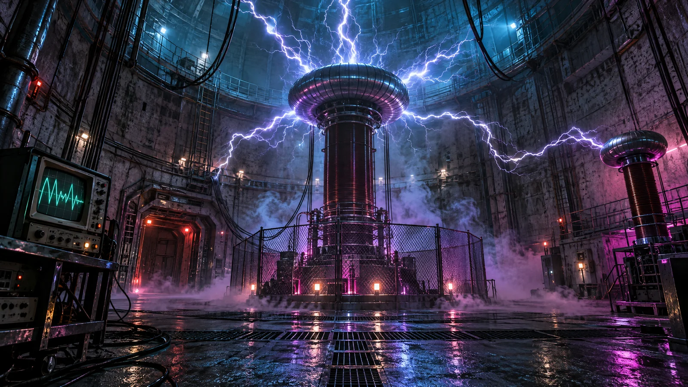
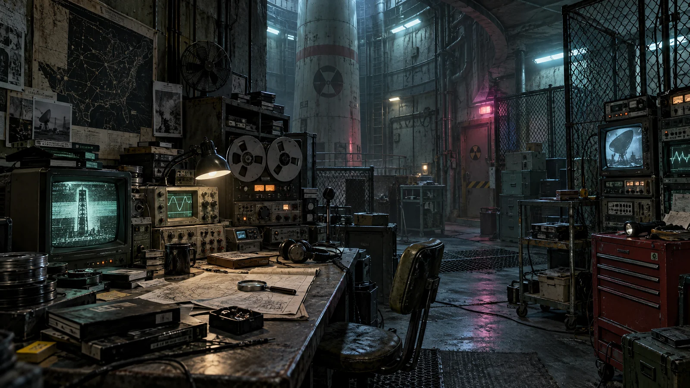
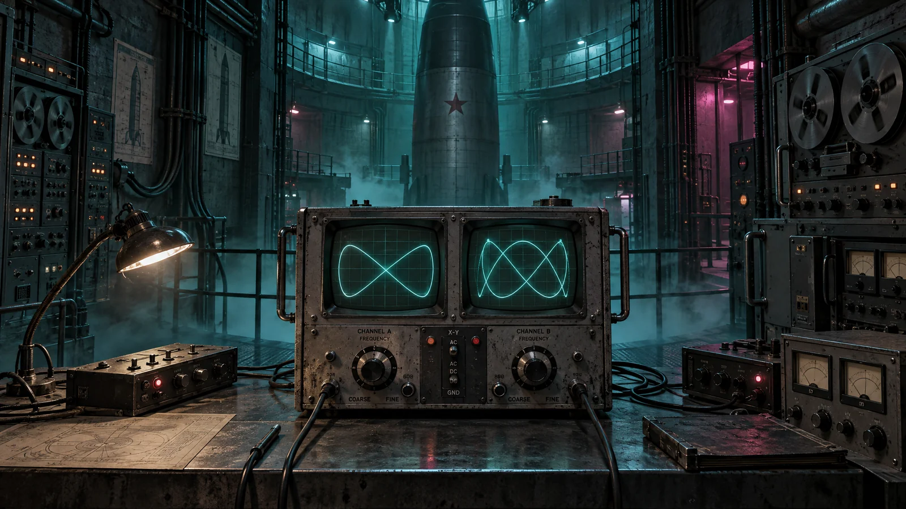

# The Alien Connection // Station Echo-7

> **"We do not come from above. We have been asleep under your continent for three hundred million years. Your drill awakened the nerve endings."**

*The Alien Connection* is a retro sci-fi analog horror and mystery puzzle game. The primary game is now a **native Solar2D application**, written in Lua and playable in the Solar2D Simulator or as a Solar2D mobile/desktop build. The original Phaser/Vite browser version and Azure deployment scaffold remain available as an alternate build.

## 🚀 Play with Solar2D

1. Install the [Solar2D Simulator](https://solar2d.com/).
2. Open this repository's `main.lua` in the Simulator, or open the repository folder as a Solar2D project.
3. Use touch or mouse to investigate rooms, collect the six lab components, tune the oscilloscope, enter the vault code, and finish the transmission.

The Solar2D game is self-contained: it uses procedural vector graphics and Solar2D's built-in JSON module, with no external art, audio, or Lua packages. Progress can be saved from the in-game **SAVE** button and resumed from the title screen.

To build a standalone app, open the project in Solar2D Simulator and choose **Build** for the target platform. `config.lua` configures the 960 × 640 landscape game canvas.

### Optional browser version

The original browser client is still available using Node.js 18+:

```bash
npm install
npm run dev
npm test
npm run build
```

---

## 📻 Story & Setting: Chapter 1 — *The Signal Below*

**October 1983.** Four thousand meters beneath the sub-arctic permafrost, the decommissioned missile silo housing the **Blackwood Bio-Acoustic Research Array (Station Echo-7)** went completely dark four hours after locking onto an anomalous deep-core radio frequency.

You arrive as the sole emergency field engineer dispatched to assess the quarantine lockdown. As you restore auxiliary power and delve into the abandoned communications lab, you uncover fragmented audio logs and scribbled notes left behind by lead researcher Dr. Aris Thorne. The telemetry antennas were never receiving transmissions from space—they were pointed straight down into the continental bedrock.

---

## 🖼️ Scenes

| Scene 1 – Static Ward | Scene 2 – Communications Lab | Scene 3 – Oscilloscope Puzzle |
| :---: | :---: | :---: |
|  |  |  |

---

## 🎮 Gameplay Features

### 1. Retro Sci-Fi / Analog Horror Atmosphere
- **CRT Simulation**: Scanlines, phosphor glow, screen curvature, and monitor flicker.
- **Procedural Web Audio Synthesizer**: Low-frequency subsonic droning, heterodyne interference beats, electromagnetic relay clicks, tactile push-button tones, and atmospheric stingers without heavy external audio files.
- **Narrative-Driven Mystery**: Psychological suspense, isolation, and unsettling revelation over gratuitous gore.

### 2. Cluttered Hidden-Object Investigation (Communications Lab & Archive)
- Search an authentic 1980s telecommunications workstation littered with debris, overturned furniture, magnetic tape spools, and creeping bioluminescence.
- Recover 6 critical components and clues:
  - 📼 **De-gaussed Data Reel**: Magnetic telemetry recording from the borehole hydrophone.
  - 🎛️ **Emergency Tuner Dial**: Knurled potentiometer required to calibrate the oscilloscope receiver.
  - 🪪 **Bio-Safety Level 2 Pass**: Dr. Thorne's contaminated access keycard.
  - 💡 **Thermionic Vacuum Tube**: High-frequency amplifier valve to boost the carrier wave.
  - 📄 **Dr. Thorne's Diary Fragment**: Field notes containing frequency formulas and vault hints.
  - 📟 **EMF / Radiation Dosimeter**: Analog dosimeter reading anomalous electromagnetic flux.
- Real-time checklist tracking, item inspection popups, and reward feedback.

### 3. Retro Sci-Fi Puzzles
- **Puzzle 1 — Analog Oscilloscope Carrier Alignment**:
  - Calibrate carrier frequency (`84.7 kHz`) and harmonic modulation (`65%`) using fine and coarse adjustment buttons.
  - Dynamic dual-waveform Lissajous CRT simulation with audio heterodyne resonance feedback.
  - Synchronizing the wave deciphers an encrypted extraterrestrial broadcast and reveals the facility override sequence.
- **Puzzle 2 — Sub-Vault 9 Isolation Keypad (Gatekeeper to Climax)**:
  - Tactile 3x4 analog push-button keypad with digital LED readout and mechanical relay sounds.
  - Deducible from Dr. Thorne's field notes (`log_03_thorne_notes`) and the decoded transmission (`log_04_intercept`).
  - Correct code: **`5729`** (Core `5`, Array `7`, Bio-Pass `2`, Vault `9`).
  - Unseals the pneumatic blast doors to the borehole core.

### 4. Sub-Vault 9 Climax & Revelation
- Step into the deep subterranean shaft to confront the suspended extraterrestrial monolith.
- Play Dr. Thorne's final black box recording to uncover the true nature of Station Echo-7.
- Complete Chapter 1 with full investigation telemetry statistics (time elapsed, logs decrypted, components found).

### 5. Robust Game State & Persistence
- Complete in-memory state tracking for inventory, logs, scene transitions, and puzzle completion.
- Local persistence via `localStorage` (auto-restore on reload).
- Remote save/load endpoints integrated with Azure Functions.

---

## 🛠️ Solar2D Game Features

- **Platform and language**: [Solar2D](https://solar2d.com/) with Lua
- **Rendering and input**: native Solar2D display objects and touch controls, including mouse input in the Simulator
- **Progression**: airlock, hidden-object lab, oscilloscope calibration, vault keypad, and finale
- **Persistence**: local JSON save in Solar2D's Documents directory
- **Assets**: all room art and interface graphics are drawn procedurally; no downloads required

---

## 🌐 Legacy Browser Build

The alternate Phaser 3 / TypeScript implementation remains in `src/` and can still be run and tested with the npm scripts above. It retains the original Vite and Azure Static Web Apps deployment setup.

---

## ☁️ Azure Static Web Apps Deployment

This repository includes a production-ready GitHub Actions workflow at [`.github/workflows/azure-static-web-apps.yml`](.github/workflows/azure-static-web-apps.yml) configured for Azure Static Web Apps.

### Deployment Architecture
- **App Location**: `/`
- **Output Location**: `dist`
- **API Location**: `api` (Azure Functions Node/TypeScript)
- **Routing Configuration**: [`staticwebapp.config.json`](staticwebapp.config.json) handles client-side routing fallback, security headers, and MIME types.

### Steps to Deploy to Azure
1. **Create an Azure Static Web App resource**:
   - In the [Azure Portal](https://portal.azure.com/), click **Create a resource** -> **Static Web App**.
   - Select your Subscription and Resource Group.
   - Set Name to `the-alien-connection`.
   - Choose **Plan type**: `Free` (or `Standard`).
   - Under **Deployment details**, choose **GitHub** and authorize access to `Eli-Blue/The-Alien-Connection`.
   - Branch: `main` (or your active branch).
   - Under **Build Presets**, select **Custom**:
     - **App location**: `/`
     - **Api location**: `api`
     - **Output location**: `dist`

2. **Configure GitHub Repository Secrets**:
   - When Azure provisions the Static Web App, it generates a deployment token.
   - Go to your repository settings on GitHub: **Settings > Secrets and variables > Actions**.
   - Ensure the secret `AZURE_STATIC_WEB_APPS_API_TOKEN` is set with your Azure deployment token.

3. **Deploy via GitHub Actions**:
   - Push to `main` (or open a pull request).
   - The GitHub Actions workflow will automatically build the frontend, run tests, compile the Azure Functions backend, and deploy to your Azure Static Web Apps environment.

### Environment Variables & Secrets Reference
| Variable / Secret | Description | Required |
| :--- | :--- | :--- |
| `AZURE_STATIC_WEB_APPS_API_TOKEN` | API token generated by Azure Static Web Apps for deployment authentication | Yes (in GitHub Actions Secrets) |

---

## 📁 Repository Structure

```
├── .github/
│   └── workflows/
│       └── azure-static-web-apps.yml # CI/CD deployment to Azure Static Web Apps
├── main.lua                         # Native Solar2D game and investigation flow
├── config.lua                       # Solar2D landscape display configuration
├── api/                             # Azure Functions v4 Backend Scaffold
│   ├── host.json                    # Azure Functions host settings
│   ├── package.json                 # Azure Functions dependencies (@azure/functions)
│   ├── tsconfig.json                # TypeScript configuration for Azure Functions
│   └── src/
│       └── functions/
│           ├── saveState.ts         # POST /api/saveState save endpoint
│           ├── loadState.ts         # GET /api/loadState state loader
│           └── status.ts            # GET /api/status telemetry endpoint
├── src/                             # Alternate Phaser browser client
│   ├── audio/
│   │   └── SoundEngine.ts           # Web Audio API retro sci-fi synth & sound FX
│   ├── scenes/
│   │   ├── BootScene.ts             # Procedural texture generator & preload
│   │   ├── TitleScene.ts            # Title screen, transmission intro, save load
│   │   ├── AirlockScene.ts          # Scene 1: Antechamber, power breaker, terminal
│   │   ├── LabScene.ts              # Scene 2: Communications lab & hidden-object hub
│   │   ├── OscilloscopeScene.ts     # Scene 3: Puzzle 1 analog carrier frequency tuner
│   │   ├── KeypadScene.ts           # Scene 4: Puzzle 2 bio-isolation keypad lock
│   │   ├── VaultScene.ts            # Scene 5: Sub-Vault 9 climax & reveal
│   │   └── ui/
│   │       ├── DialogueBox.ts       # Retro typewriter text dialogue box
│   │       ├── HUD.ts               # Top bar, objective ticker, inventory drawer, toasts
│   │       └── LogViewer.ts         # Terminal modal for logs & decrypted records
│   ├── state/
│   │   ├── GameState.ts             # State manager, persistence, lore registry
│   │   └── types.ts                 # TypeScript interfaces and schemas
│   ├── config.ts                    # Phaser 3 configuration
│   └── main.ts                      # Entry point and bootstrap
├── tests/                           # Automated Tests
│   ├── state.test.ts                # Game state, inventory, and persistence tests
│   ├── puzzles.test.ts              # Puzzle math, tolerances, and code validation
│   └── logs.test.ts                 # Narrative progression and lore continuity tests
├── index.html                       # CRT-styled HTML container with scanline overlay
├── staticwebapp.config.json         # Azure Static Web Apps routing & headers
├── tsconfig.json                    # Frontend TypeScript configuration
├── vite.config.ts                   # Vite bundler configuration
└── package.json                     # Root dependencies and scripts
```

---

## 📜 License & Credits

Created for **The Alien Connection** project. All textures and audio are procedurally generated in code without proprietary third-party visual or audio assets.
